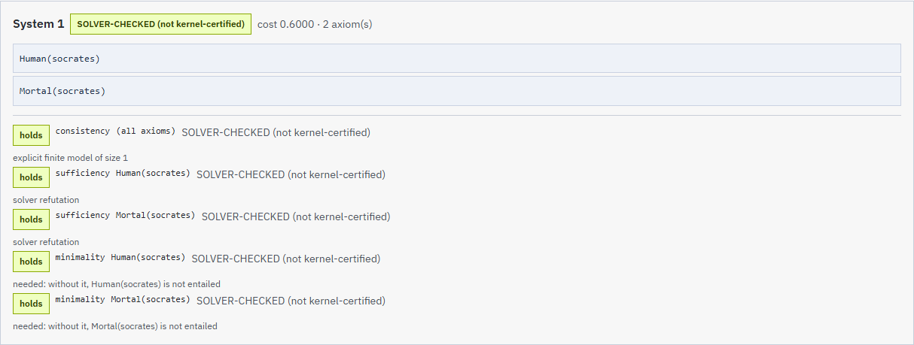

# Common Ground

[](https://github.com/ysmouhib/common-ground/actions/workflows/ci.yml)
[](LICENSE)
[](engine/pyproject.toml)
[](.github/workflows/ci.yml)

Does a conclusion follow from the premises someone gave for it? And when two
positions disagree, where exactly, and what could both still hold?

Common Ground answers those two questions for arguments written as first-order
formulas, and says what backs each answer: an explicit model, a refutation, or a
proof checked by the Lean 4 kernel. It certifies **deductions, not truth**. Whether
a premise is true, and whether a formula says what a sentence meant, stay separate
questions with separate evidence.

It has two parts:

* `engine/`: a Python logic engine (parser, two solvers, Lean certificates,
  conflict analysis, a benchmark);
* a web app that walks through one sourced policy debate using the engine's output.

## Quickstart

Engine only — verdicts and debate analysis, no server, no database:

```bash
git clone https://github.com/ysmouhib/common-ground.git && cd common-ground
pip install -r engine/requirements.txt
cd engine
python -m commonground analyze examples/plastic_bags.json
python -m commonground check --premise "∀x (Human(x) → Mortal(x))" --premise "Human(socrates)"     --conclusion "Mortal(socrates)" --lean    # the Lean step needs LEAN_BIN set
```

Web app: `npm ci`, copy `.env.example` to `.env` and set `DATABASE_URL` (MySQL)
and `REVIEWER_TOKEN`, `npx drizzle-kit push --force`, `npm run dev`.

A live language-model run needs an endpoint you configure — the exact commands
are under "What has not been shown" below. The paste-your-own-debate flow is in
the web app (Phase 6 of [`docs/PLAN.md`](docs/PLAN.md)); the engine CLI above works
without it.
in a few minutes; the 10-minute acceptance test for the full release is
CG9-11 in the plan (not run here).

## What you can do with it today

All engine commands run headless (no server, no database). Every verdict is
kernel-checked, solver-checked, or shown as pending — never silently picked.

| You want to… | Command | You get |
|---|---|---|
| Check whether a conclusion follows from premises | `python -m commonground check --premise "∀x (Human(x) → Mortal(x))" --premise "Human(socrates)" --conclusion "Mortal(socrates)" --lean` | a verdict backed by a Lean-kernel proof, or a solver refutation with an explicit countermodel (on FOLIO: 128/128 kernel-certified, 0/278 false accepted) |
| See where a debate stands | `python -m commonground analyze examples/plastic_bags.json` | compatible / minimal conflicts / smallest concessions; `examples/remote_work.json` shows 2 conflicts and 8 ways out |
| Turn texts into statements | `python -m commonground extract doc.txt --base-url … --model … --out out` | statements with verbatim quotes and spans, plus support/attack relations |
| Reconstruct what one camp's claims rest on | `python -m commonground camp record.json --candidates cand.json --lam 0.3 --lean --out out` | `out/report.md`: the selected axioms are **verified sufficient** — e.g. "System 1 — cost 1.0000 — SUFFICIENT (kernel-checked)" — with load ranking, negative controls, and — when `--plausibilities` gives ranges — a plausibility-sensitivity section |
| Compare two camps | `python -m commonground co2 --out co2-out` (bundled CO2 vote), or `crosscamp A.json B.json --candidates a.json b.json --out out` | `crosscamp.md`: provable common ground (two tiers) and the exact fault lines; on the CO2 example the camps are consistent and diverge at the root (top-ranked axiom pair, rank 8) |

The Camps, Axiom queue and Compare views all work now (CG6-3/CG6-4); the engine CLI
above works standalone too.

### What a report looks like

The Axiom queue view running a small demo record (screenshot from a real run of this build —
one selected system with its badge, its axioms, and every check with its outcome, badge and
detail):



The same report as Markdown, as the CLI writes it for the bundled CO2 `no` camp
(`results/co2-exhaustive/no/report.md`, exhaustive search complete, 2,048 checks):

```markdown
## Selected systems (cost-minimal, ties reported)

### System 1 — cost 2.7000 — SOLVER-CHECKED (not kernel-certified)

Axioms:

- `(MainlyHitsLowIncome(law) ∧ Unjust(law))`
- `(PriceRise(petrol) ∧ PriceRise(diesel))`
- `(Radical(law) ∧ OnlyBansAndRules(law))`
- `CostsRise(averageFamily, high)`
- `NoEffectOnClimate(law)`
- `TinyShareOfEmissions(switzerland)`
```

## What has been shown, and by what

| Claim | Evidence | Reproduce |
|---|---|---|
| Given FOLIO's own formulas, the engine's verdict equals FOLIO's label on **195 of 204** validation examples (95.6 %) | run recorded in `results/folio-validation/` | `python -m commonground folio --out out --lean` |
| The other 9 are places where the dataset's formulas do not yield the dataset's label | two re-checked models or a kernel-checked proof per example: [`AUDIT.md`](results/folio-validation/AUDIT.md) | same |
| Every "follows" / "contradicts" verdict of that run is **certified by the Lean kernel: 128 of 128**, in about 2 s | `summary.json` → `lean` | same |
| Lean accepted **0 of 278** false statements offered to it (the opposite of each verdict, both directions for the open ones) | `summary.json` → `lean` | same |
| Every "does not follow either way" verdict (75) comes with two finite models, re-checked by an evaluator that imports no solver | `engine/commonground/model.py`, `per_example.csv` | same |
| A second, independent engine (grounding to SAT) agrees on **201 of 201** examples where it is definite | `summary.json` → `second_engine` | same |
| On all 204 FOLIO validation examples, the example's own premises contain a **solver-checked sufficient subset for its conclusion on 68 of the 203 parsed** (33.5 %, 95 % Wilson 27.4–40.2 %); the recovered subsets average 3.68 premises against 5.31 given; 1 example unparsed, 9 with unequal sentence and formula counts (flagged, not crashed), 0 searches incomplete, 0 pools too large | `results/abduction-full/summary.json` (solver-only run, so every row is SOLVER-CHECKED) | `cd engine && python -m commonground --timeout-ms 3000 folio --data <FOLIO clone> --mode abduction --out ../results/abduction-full` |
| On the bundled CO2 vote, each reviewed statement is re-derived from the rest when withheld in turn on **2 of 7** "yes" and **2 of 6** "no" statements (28.6 %, Wilson 8.2–64.1 %; 33.3 %, Wilson 9.7–70.0 %) | `results/co2-holdout/summary.json` | `cd engine && python -m pytest tests/test_golden.py -k holdout` |
| The path a language model's reply takes (JSON, validation, solver) adds no error of its own: fed the dataset's formulas, it returns the reference verdict on all 203 examples whose formulas parse, and no answer on the malformed one | `engine/tests/test_bench.py` | `FOLIO_DIR=… python -m pytest tests/test_bench.py` |
| In 10 of the 204 examples the dataset has a different number of sentences and formulas, so "one formula per sentence" cannot be met on them | [`AUDIT.md`](results/folio-validation/AUDIT.md) | same as the first row |
| In the worked debate the two positions are compatible, and each proof's premise list is exactly the one minimal set that entails its conclusion | `contracts/analysis.generated.ts`, `contracts/analysis.test.ts` | `npm test` |
| The web app does what this page says for a visitor and for a reviewer: 41 checks over real HTTP, MySQL, Lean and a browser (engine bridge included), and 11 more on a deployment with no reviewer token | `e2e/run.mjs` | `npm run e2e` (below) |

The CI workflow (`.github/workflows/ci.yml`) re-runs all of it on every pull
request and on every push to `main`: the test suites, the benchmark (it fails if
a published number changes), and the end-to-end checks against the container
image built from the `Dockerfile`. The badge above shows the last run on `main`.

### What has not been shown

* **No language model was run for these numbers.** The benchmark starts from the
  dataset's formulas. It measures the logic back end and audits the annotations;
  it is a ceiling for any formalizer scored against those labels, not a result
  about formalization.
* **The language-model formalizer (`engine/commonground/formalize.py`) has been run
  against one live model only** — deepseek-flash, temperature 0, 13 and 14 November 2026
  (runs recorded in `results/direct/`, `results/llm/`, `results/llm-4000/` and `results/direct-4000/`, every reply kept). It is
  also tested with scripted clients, a local HTTP stub and a replay of the
  dataset's own formulas. No other model, provider or setting has been benchmarked.
  Reproduce with workflow `model-benchmark`, inputs `base_url=https://api.deepseek.com/v1`,
  `model=deepseek-flash`, every other input at its default:

  | Mode | Accuracy on FOLIO validation | Accuracy when it answers |
  |---|---|---|
  | model answers directly | 162 of 204 (79.4 %, 95 % Wilson interval 73.3–84.4 %) | 162 of 194 (83.5 %, 77.6–88.1 %) |
  | model formalizes, solver decides | 119 of 204 (58.3 %, 51.5–64.9 %) | 119 of 146 (81.5 %, 74.4–87.0 %) |
  | model formalizes, solver decides, reply limit 4000 | 145 of 204 (71.1 %, 64.5–76.9 %) | 145 of 189 (76.7 %, 70.2–82.2 %) |
  | model answers directly, reply limit 4000 | 163 of 204 (79.9 %, 73.9–84.8 %) | 163 of 198 (82.3 %, 76.4–87.0 %) |

  ```bash
  export LLM_API_KEY=...   # any endpoint that implements POST {base-url}/chat/completions
  python -m commonground folio --mode direct --base-url https://… --model … --out results/direct
  python -m commonground folio --mode llm    --base-url https://… --model … --out results/llm
  python -m commonground report results/direct results/llm
  ```

  `report` prints both accuracies with 95 % Wilson intervals and an exact McNemar
  test on the examples where exactly one of the two runs is right. With 204
  examples an interval reaches 3 to 7 points to each side, so a small difference
  between two runs is not evidence of anything, and the report shows that in
  numbers. In the recorded deepseek-flash runs the two modes disagreed on 61 of
  204 examples (52 right only when answering directly, 9 only when formalizing;
  exact McNemar p ≈ 1.8×10⁻⁸): the direct mode is ahead on this dataset, mostly because
  58 of the 204 examples produced no parseable formalization. Both runs limited a reply to
  2000 tokens (`--max-tokens 2000`; the workflow default moved to 4000 on 2026-11-14), and all
  four arguments longer than 1000 characters are among the 58. Re-run on 14 November 2026
  with a 4000-token reply limit (`results/llm-4000/`): 145 of 204 right and 15
  NoFormalization instead of 58. On the same 204 examples the two reply limits agree on
  170 (115 both right, 55 both wrong); the 4000 limit is right where the 2000 limit is
  wrong on 30 examples and the reverse on 4 (exact McNemar p = 6.2×10⁻⁶). The direct run was
  re-run at a 4000-token reply limit (`results/direct-4000/`): 163 of 204 right (79.9 %), 198
  answered, 6 Invalid. Paired with `results/llm-4000/` at the same reply limit: both right on
  136, only direct on 27, only formalizing on 9, neither on 32 (exact McNemar p = 0.0039) —
  at equal reply limits the direct mode stays ahead. The workflow input `max_tokens=4000`
  reproduces both 4000-token rows. A run is resumable, names its
  model and settings in `config.json`, and stops instead of scoring a provider
  outage as wrong answers. Providers differ: add `--no-json-mode` or
  `--no-temperature` for one that rejects `response_format=json_object` or any
  temperature but its default.

  The same three commands run from the repository's Actions tab: workflow
  `model-benchmark`, "Run workflow". It needs a repository secret `LLM_API_KEY`
  and uploads every reply and verdict.
* **The statement extractor (`engine/commonground/extract.py`) has been run against one
  live model** — deepseek-flash, temperature 0, 14 November 2026, on the two CO2 camps'
  statements (587 and 542 characters, `results/extract-co2/yes.txt` and `no.txt`),
  recorded in `results/extract-co2/`, `results/extract-co2-4000/` and
  `results/extract-co2-8000/`. At a 2000-token reply limit and at 4000, both
  documents failed (NoExtraction after 3 attempts each) — diagnosed as the model spending
  the whole reply limit on reasoning tokens before writing any JSON. At an 8000-token
  limit: 2 of 2 documents, 13 statements and 6 relations, every span verbatim, and all 13
  golden statements of `examples/co2-2021/statements.json` returned exactly; the model
  spent 4.1k–8.0k completion tokens per attempt, almost all of it reasoning. Not run
  (kept outside the repository): three longer documents (3,100, 3,072 and 16,020
  characters) gave 0 of 3 at 2000 and at 4000, and the two ~3,000-character ones 0 of 2
  even at 16000. So on this model it works on short documents only with a reply limit of
  8000, and on no document of 3,000 characters or more at any limit tried. It is also
  tested with scripted clients and a local HTTP stub, including a full CLI run against
  the stub. Every statement it returns is a verbatim quote that the engine locates in
  the source text (first unused occurrence; any quote that is not there is rejected).
  The recorded runs above predate the 2026-11-14 prompt change (quotes only, no offsets;
  default reply limit 8000). Re-run live after the change (2026-11-14, `results/extract-co2-v2/`
  at the 8000 default and `results/extract-co2-v2-2000/` at 2000): 2 of 2 documents, 13 statements,
  5–6 relations, 0 failed, **one attempt each**, 955–1,470 completion tokens per document at 8000
  and 964–987 at 2000, all 13 golden statements returned exactly, every quote verbatim. So with the
  quote-only prompt the extractor works on these short documents even at a 2000-token limit; the
  longer-document failures above were recorded with the old prompt and were not re-run.

  ```bash
  export LLM_API_KEY=...   # any endpoint that implements POST {base-url}/chat/completions
  python -m commonground extract file1.txt file2.txt --base-url https://… --model … --max-tokens 8000 --out results/extract
  ```

  The run is resumable and writes `runs.jsonl`, `config.json` (model and settings) and
  `summary.json` to the output directory; a provider outage stops it, never scores it.
* **The abduction benchmark run used no Lean** (every row SOLVER-CHECKED) **and no live model proposed the candidate pool** — that mode needs an endpoint and `LLM_API_KEY`. Recorded in `results/abduction-full/`; the earlier 25-example slice stays in `results/abduction-25/`.

* **The CO2 holdout covers a tiny corpus and skips the selection search.** With 7 and 6 withheld statements the two Wilson intervals (8.2–64.1 % and 9.7–70.0 %) overlap almost completely, so the camps' proportions are not distinguishable; and per AUDIT-4 the 16-item "yes"-pool search does not finish under the check cap, so the holdout rebuilds with the golden candidate extraction (CG7-2) instead — `results/co2-holdout/summary.json` says so in its note. It measures coverage of the reconstruction on one small corpus, not a property of either camp.

* **Faithfulness is not certified by anything here.** A formula can be provably
  entailed and still not say what the sentence meant.
* **The container image has been built only by CI**, not on a developer machine.
  The hosted copy on the original platform has not been redeployed from this
  version.

## How a verdict is produced

```
text (dataset / model / reviewer)
   │  fol.py        strict grammar → syntax tree; anything else is rejected
   ▼
premises, conclusion
   │  verdict.py    is "premises ∧ ¬conclusion" satisfiable? is "premises ∧ conclusion"?
   │                 Z3, with grounding to SAT (PySAT) as second engine and fallback
   ▼
True / False / Uncertain / Inconsistent / Undecided
   │  model.py      every "satisfiable" claim → explicit finite structure, re-evaluated
   │  lean.py       every "unsatisfiable" claim → Lean 4 theorem, kernel-checked, axioms audited
   ▼
verdict with evidence
```

Grounding is a decision procedure for sentences with no existential under a
universal (the Bernays–Schönfinkel class): 200 of the 203 parsed FOLIO examples.
Outside it, an "unsatisfiable" from grounding is reported as bounded, never as a
proof (`engine/commonground/ground.py`).

## Where two positions disagree

`engine/commonground/argmap.py` treats a debate as a set of formal statements owned
by positions and computes, by search:

* whether the positions are **compatible** (all premises together have a model);
* the **minimal conflicts** (minimal unsatisfiable subsets) when they are not;
* the **smallest concessions** that restore consistency (minimal correction sets);
* for each conclusion, every **minimal set of premises that entails it**.

Enumeration is MARCO with a SAT solver proposing subsets. It is tested against
brute force and against the hitting-set duality between conflicts and concessions.

```bash
cd engine
python -m commonground analyze examples/plastic_bags.json   # the sourced worked example: compatible
python -m commonground analyze examples/remote_work.json    # a constructed contradiction: 2 conflicts, 8 ways out
python -m commonground check --premise "∀x (Human(x) → Mortal(x))" --premise "Human(socrates)" \
                             --conclusion "Mortal(socrates)" --lean
```

v2 adds the reconstruction pipeline (per-camp axiom systems, then cross-camp common
ground and fault lines). Both bundled examples run headless end to end (recorded
2026-11-14, exit 0):

```bash
python -m commonground analyze examples/plastic_bags.json   # v1 debate analysis
python -m commonground co2 --max-checks 150 --out co2-out    # CO2 golden corpus: <camp>/report.{json,md} + crosscamp.{json,md}
```

The pool search is bounded by `--max-checks` (AUDIT-4). With 150 checks neither camp's
search finishes, and the reports say so: each shows its certified stated system under
"SEARCH INCOMPLETE", with abstention pending and the hull marked partial — a search the
budget stopped is never reported as cost-minimal. The exhaustive search was run once for
both camps (recorded 2026-11-14 in `results/co2-exhaustive/`, `--max-checks 70000
--timeout-ms 3000`, about 20 minutes: 2,048 checks for `no`, 10,044 for `yes`, none
undecided): at λ=0.3 each camp's stated system is the only cost-minimal one, so both
The default cap is 12000 checks (raised from 4000 on 2026-11-14), which finishes
both searches — about 20 minutes on this machine.
hand-worked golden are audited in `AUDIT.md`, never silently substituted.

## The web app

One debate (should a city adopt a well-designed single-use plastic bag policy?)
reconstructed as 15 statements with five sourced evidence records, four Lean
proofs and one negative control that Lean must reject. A certificate is active only
while Lean accepted the exact current source, the stored hash matches and every
premise it uses is approved; disputing a premise suspends the conclusions that
depend on it.

"A priority dispute, not a contradiction" used to be a sentence in the interface.
It is now computed: the engine finds a model of all premises of both positions and
the page says so, or lists the conflicts if there are any.

```bash
npm ci
cp .env.example .env          # DATABASE_URL (MySQL); REVIEWER_TOKEN to enable review
npm run db:push
npm run dev                   # http://localhost:3000
npm run lint && npm run check && npm test && npm run build
```

Without `REVIEWER_TOKEN` the app is read-only, and its first log lines say so. Without a Lean executable
(`LEAN_BIN`, Lean 4.35.0) it shows the stored certificates and reports live
verification as unavailable; it never simulates a compiler result. A Lean run that
does not finish in time (`LEAN_TIMEOUT_MS`, 60 s by default) is reported as "no
verdict" and leaves the stored certificate as it was.

### End-to-end checks

```bash
npm run build && npm start &                       # the production build, with .env as above
E2E_REVIEWER_TOKEN=<the same token> npm run e2e    # add E2E_BASE_URL=… if not http://127.0.0.1:3000
```

They go through the real server, database and a Chromium browser
(`npx playwright install chromium` once): what an anonymous visitor can and cannot
do, a dispute suspending exactly the certificates that depend on the premise, a live
Lean batch, the response headers, the limits, and the page on a phone-sized screen.
The last check locks the address the checks ran from out for 15 minutes, to read
the message a locked-out reviewer gets, so restart the server before repeating
them. `E2E_READ_ONLY=1 npm run e2e` checks a server started without a token.

### Container

```bash
docker build -t common-ground .
docker run --env-file .env -p 3000:3000 common-ground
```

The image is built from source, holds no configuration and runs as an
unprivileged user. It contains no Lean, so it serves the stored certificates.

## Security

Reading is public. Review decisions, AI drafts and Lean runs need a reviewer
token; ten wrong tokens lock a client out; there are rate limits, a strict
Content-Security-Policy, and no secret in the default container image. No text
from a visitor or a model is ever passed to Lean. Each control, the test that
covers it and the known limits: [`SECURITY.md`](SECURITY.md).

## Repository map

```
engine/commonground/   fol.py parser · verdict.py · smt.py (Z3) · ground.py (SAT) · model.py (evaluator)
                       lean.py (certificates) · argmap.py (conflicts) · bench.py · folio.py (dataset)
                       formalize.py (language model to formulas) · extract.py (statements with verbatim spans)
                       abduce.py (axiom systems, cost, per-camp report) · load.py · crosscamp.py (common ground,
                       fault lines)
engine/tests/          345 tests: properties, differential checks between engines, Lean soundness probes,
                       the model path with scripted clients, the search against brute force, the CO2 golden corpus
engine/examples/       two debates as formulas
examples/co2-2021/     golden corpus: the Swiss CO2-law vote of 13 June 2021, statements and hand-worked target
results/               benchmark output (FOLIO, model runs, abduction, CO2 holdout) and the annotation audit
AUDIT.md               where the pipeline and the hand-worked CO2 target differ, and why
docs/                  PLAN.md (state) · BACKLOG.md · design/ (abduction, cross-camp) · research/ (THEORY, RESEARCH)
api/                   Hono + tRPC server, access control, Lean runner, AI drafts, engine bridge (camp,
                       crosscamp, extract)
contracts/             Lean sources, certificate hashes, generated analysis, engine report whitelists
                       (with api/: 57 tests)
db/                    schema, worked-example data, stored Lean outputs
proofs/                the worked example's Lean files
src/                   React interface: debate, evidence, proofs, camps, axiom queue, comparison
e2e/                   end-to-end checks against a running build
.github/workflows/     ci.yml (tests, benchmark, container, end-to-end) · model-benchmark.yml (manual)
                       release.yml (container image to GHCR on a version tag)
```

## How this was built

* The web app was scaffolded with Kimi's site builder; `api/ai-client.ts` and the
  build setup are that platform's template code.
* The logic engine, the access-control layer, the tests and this README were
  written with Claude (Anthropic) in working sessions on 9–10 November 2026,
  following a review of the first version. I directed the work and decide what is
  claimed here.
* Every number above was produced by the commands shown, on this machine with Python
  3.12.10, Z3 5.4.1, PySAT 1.9.dev22 and Lean 4.35.0 — the versions each run records in
  its `summary.json`. The CI workflow repeats the run.
## Limits

* One debate at a time, entered by hand or pasted into the Camps view; the `extract`
  route turns a pasted text into statements.
* First-order logic over one kind of object, without arithmetic or modality. Most
  real arguments are not deductive; this tool only sees the part that is.
* The conflict analysis enumerates all minimal conflicts, which is exponential in
  the worst case. It is meant for tens of statements.
* Limits and review state assume a single server process.

## Data and licence

* FOLIO (Han et al., *FOLIO: Natural Language Reasoning with First-Order Logic*)
  is licensed CC BY-SA 4.0. It is downloaded on demand and not redistributed;
  `results/` refers to examples by line number.
* The five evidence records quote short excerpts from their sources, each linked
  in the app. Each excerpt, date and author line was compared with the source
  page or PDF on 9–10 November 2026 and changed where it differed: one excerpt
  was not the source's wording, one stops before its sentence ends and is now
  marked as cut, one date was a day off, and one record's author, publisher and
  date lines now follow what the report prints.
* This repository is MIT-licensed — see [`LICENSE`](LICENSE).
